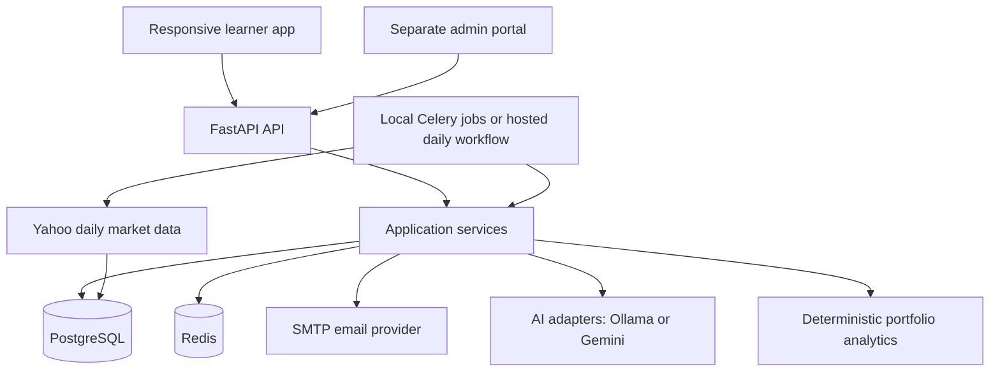

# InvestIQ

**Learn investing. Build virtual portfolios. Understand your performance.**

InvestIQ is an investment learning platform built end to end as an MBA project. It combines virtual portfolio contests, daily performance analytics, evidence-backed AI coaching, courses, and community discussions in a responsive web application.

[Live application](https://invest-iq-psi-mocha.vercel.app) · [Admin portal](https://invest-iq-admin.vercel.app) · [Deployment guide](deployment/README.md)

> All capital, holdings, fees, and rewards are simulated. InvestIQ does not execute trades, handle investments, or provide financial advice. Subscription activation is a demonstration feature; no payment gateway or real billing is integrated.

## Features

### Compete and build portfolios

- Start with a shared ₹10,00,000 virtual wallet. New contest entries reserve capital; daily valuations update invested value, and final results return funds to the available balance.

- Discover platform-hosted public contests and user-created public or private leagues.
- Join contests, build portfolios using weights or whole-share quantities, and review allocations before submission.
- Enforce contest-specific eligibility, holding limits, position caps, deadlines, and capital constraints on the server.
- Save versioned drafts and confirm immutable submissions; published contest rules remain frozen.
- Explore eligible stocks in a compact market view with prices, percentage changes, filtering, and sorting.

### Review investment performance

- Track virtual portfolio value, profit and loss, returns, benchmark comparisons, rank, and drawdown.
- Inspect daily snapshots and holding-level contributions with color-coded gains and losses.
- Follow contest standings and distinguish current, pending, stale, and final results.
- Distinguish contest-level performance from the shared wallet's available balance, invested value, and overall profit or loss.

### Learn with AI

- **Ask Martin:** a conversational copilot for investing concepts and questions about the user's saved contest performance.
- **Personalized insights:** plain-language observations about diversification, concentration, market comparisons, and learning priorities.
- **Performance coach:** evidence-backed contest reports linked to relevant lessons and reflection exercises.
- **Configurable providers:** Ollama for local development and Gemini for hosted inference, with an explicit disabled mode.

### Learn with others

- Enroll in courses, complete lessons and quizzes, and track learning progress and XP.
- Create or join communities and access their member feeds, discussions, polls, replies, upvotes, and saved posts.
- Earn virtual coins and explore sandbox reward redemptions.
- Manage profile information, profile photos, account settings, and simulated subscription access.

### Admin workspace

A separate admin portal focuses on contest administration and publishing courses, lessons, and quizzes. Administration requires a verified account with an operator-assigned role; public signup cannot grant admin access.

## Technology stack

| Layer | Technologies |
| --- | --- |
| Frontend | JavaScript ES modules, Vite, HTML, CSS, responsive hash-based routing |
| API | Python 3.13, FastAPI, Pydantic, Uvicorn |
| Persistence | PostgreSQL, async SQLAlchemy, asyncpg, Alembic |
| Redis | Rate limiting, caching, AI usage allowances; Celery broker in local worker mode |
| AI | LangChain, LangGraph, PostgreSQL checkpoints, Ollama, Gemini |
| Market data | Yahoo daily prices through `yfinance`, versioned stock catalogues, isolated synthetic fixtures |
| Background processing | Celery and Beat locally; bounded GitHub Actions jobs in hosted demo mode |
| Testing | pytest, HTTPX, Playwright, Ruff, mypy |
| Hosting | Vercel, Neon PostgreSQL, Upstash Redis, SMTP email delivery |

The frontend uses vanilla JavaScript rather than React. The backend is a modular monolith with separate API, service, persistence, analytics, provider, and job layers.

## Architecture



API requests manage identity, content, contest membership, and portfolio submissions. Background processing imports completed market sessions, publishes valuations and standings, and discovers eligible coaching work. Saved snapshots remain readable independently of model availability.

### AI design

Portfolio accounting and performance metrics are calculated by deterministic application code. Models explain authorized evidence and learning content; they do not calculate authoritative balances, set rankings, or place trades.

Ask Martin distinguishes general learning questions from personal performance questions. Personal responses are grounded in the authenticated user's available records, and generated evidence references are validated before an answer is accepted. Insufficient evidence produces a limitation rather than an invented assessment.

Provider adapters, structured output validation, timeouts, rate limits, durable job state, and idempotent processing separate inference from core product behavior. Deterministic learning checks remain available when generation is disabled. Generated reports follow eligible published results rather than changing on every page visit.

### Market data and valuation

- Yahoo mode imports completed daily sessions, not live trading ticks.
- The Nifty 50 universe is a versioned constituent snapshot reviewed on **25 October 2026**, rather than an automatically refreshed membership feed.
- Portfolio confirmation uses the latest complete available closing session. Daily valuation uses the submitted share quantities at the session's closing prices plus residual virtual cash, with the recorded simulated fee reflected in performance.
- Index opening and closing levels provide market context; index open-to-close movement is distinct from portfolio return.
- Incomplete Yahoo batches remain unavailable. Synthetic prices never silently replace missing Yahoo data.
- Existing published contests retain their original eligible universe and price source.

See [Yahoo end-of-day integration](investiq-be/docs/YAHOO-EOD.md) for source validation, publication rules, corporate-action limitations, and import commands.

## Run locally

### Prerequisites

- Node.js **22.12+** and npm.
- Docker with Docker Compose, running locally.
- Optional: Python **3.13** and `uv` for host-based backend development and operator commands.
- Optional: Ollama with `llama3.1:8b` installed for local AI generation.

### 1. Clone the repository

```bash
git clone https://github.com/prabalgautamiitb/invest-iq.git
cd invest-iq
```

### 2. Start the backend and dependencies

```bash
cd investiq-be
cp .env.example .env
```

For an initial run without a model server, set this value in `.env`:

```dotenv
INVESTIQ_AI_PROVIDER=disabled
```

Then start the full local stack:

```bash
docker compose --profile app up -d --build --wait
```

This starts PostgreSQL, Redis, Mailpit, the API, a worker, and one scheduler, and runs migrations and development content initialization. Keep an existing `.env` when restarting; do not overwrite it with the example.

### 3. Start the frontend

From another terminal at the repository root:

```bash
cd investiq-fe
cp .env.example .env
npm ci
npm run dev
```

| Service | Local URL |
| --- | --- |
| Learner app | http://localhost:5173 |
| Admin app | http://admin.localhost:5173 |
| API documentation | http://127.0.0.1:8080/docs |
| Verification and recovery inbox | http://localhost:8025 |

Register an account and open Mailpit to verify its email before joining contests. Separate learner and admin hostnames allow independent sessions in the same browser.

The default local setup uses **fixed synthetic fixtures** with limited historical coverage. For recent daily market data, set `INVESTIQ_MARKET_DATA_MODE=yahoo` in the backend `.env`, recreate the services, and import completed sessions:

```bash
# From investiq-be
docker compose --profile app up -d --build --wait
docker compose exec -T api python -m investiq.market_cli --yahoo
```

To test a complete contest without waiting for market hours, use the separate [manual contest sandbox](investiq-be/docs/MANUAL-CONTEST-TESTING.md).

### 4. Enable AI generation

For local Ollama, install the model on the host:

```bash
ollama pull llama3.1:8b
```

Keep Ollama running, set `INVESTIQ_AI_PROVIDER=ollama` in the backend `.env`, and recreate the Compose services. The default Docker configuration reaches the host at `host.docker.internal:11434`; Linux setups may require a host-gateway mapping.

For Gemini, configure these backend-only settings instead:

```dotenv
INVESTIQ_AI_PROVIDER=gemini
INVESTIQ_GEMINI_MODEL=YOUR_SUPPORTED_MODEL
INVESTIQ_GEMINI_API_KEY=YOUR_PRIVATE_API_KEY
```

Recreate the API and worker after changing providers. Keys must never be placed in frontend `VITE_` variables or committed to Git. Model availability, quotas, and inference charges depend on the selected provider account.

### 5. Grant administrator access

Create and verify the target account first. From `investiq-be`, with the local database running:

```bash
uv sync --locked
uv run --locked python -m investiq.cli set-role you@example.com admin
```

This revokes the account's existing sessions. Sign in again through the admin portal using the same email and password. Use `user` instead of `admin` to remove access. Hosted role changes require the private production environment; see the [deployment guide](deployment/README.md).

## Verification

Frontend checks:

```bash
cd investiq-fe
npm run check
npm run build
```

Backend checks, from a separate terminal:

```bash
cd investiq-be
uv sync --locked
uv run --locked ruff check src tests/test_deployment.py app.py
uv run --locked mypy
uv run --locked pytest
```

Integration tests require local PostgreSQL and Redis. Tests create isolated databases and use namespaced Redis keys; run them with development settings. For infrastructure-independent tests, use `uv run --locked pytest -m 'not integration'`.

Browser tests run against isolated local API and frontend processes:

```bash
cd investiq-fe
npx playwright install chromium
npm run test:e2e
```

GitHub Actions runs frontend checks/builds and backend lint, typing, and tests on pushes and pull requests.

## Deployment

The hosted demo uses two Vercel projects: a learner frontend plus FastAPI services, and a separate admin frontend proxying to the same API. PostgreSQL is hosted on Neon and Redis on Upstash. Verification and recovery emails use an authenticated SMTP relay with an approved sender.

Hosted daily processing runs through the opt-in GitHub Actions workflow rather than a continuously running Celery worker. Its configured schedule is **20:47 IST, Monday–Friday**; execution can be delayed by GitHub. Manual AI requests run within bounded authenticated API requests in this mode.

Follow the [deployment guide](deployment/README.md) for environment variables, database initialization, workflow secrets, Gemini configuration, and deployment health checks. Hosting quotas and AI usage are separate considerations; this repository does not guarantee cost-free operation.

## Security and data boundaries

- Argon2 password hashing, HttpOnly cookie sessions, CSRF protection, and authentication rate limits.
- Email verification, password recovery, session revocation, and role-based administration.
- Authorization checks for private contests, personal portfolios, AI context, and member-only community feeds.
- Server-side accounting with decimal arithmetic, persisted source evidence, immutable submissions, and retry-safe valuation jobs.
- Private credentials remain in ignored environment files or provider secret stores.

## Repository structure

```text
investiq-be/
  src/investiq/
    api/           HTTP endpoints and authorization dependencies
    services/      Application workflows
    models/        Persistence models and database constraints
    analytics/     Deterministic portfolio and learning metrics
    adapters/      AI, email, and market-data integrations
    jobs/          Scheduled and background processing
  tests/           Backend unit and integration tests
  docs/            Detailed feature contracts and design decisions
investiq-fe/
  src/
    api/           HTTP client and service bindings
    features/      Product features and UI controllers
    styles/        Responsive styling
    lib/           Shared browser utilities
  public/          Browser and home-screen icons
  tests/browser/   Playwright browser tests
deployment/        Hosted setup guide and environment examples
scripts/           Deployment preparation and health checks
.github/workflows/ Application checks and hosted daily processing
```

## Scope and limitations

- This is an educational simulation and project demonstration, not a brokerage or financial advisory service.
- Returns are price-based; dividends are not reinvested. Reported splits block the affected import pending review; automatic corporate-action accounting is not implemented.
- The reviewed exchange calendar currently covers **2026** and must be extended for later sessions. Stock membership snapshots also require maintenance.
- Contest results cannot establish a user's real-world risk tolerance or long-term investing skill. AI explanations may be incomplete or incorrect and should be assessed against their evidence.
- Market-data availability depends on upstream services. Access through `yfinance` does not grant redistribution or commercial data rights.
- Rewards and subscriptions are sandbox features. There are no real payouts, fulfilled rewards, or subscription charges.

## Further documentation

- [Backend setup and API](investiq-be/README.md)
- [Frontend development](investiq-fe/README.md)
- [Shared wallet accounting and migration](investiq-be/docs/WALLET.md)
- [Portfolio submission rules](investiq-be/docs/PHASE-5.md)
- [Valuation and leaderboard calculations](investiq-be/docs/PHASE-6.md)
- [AI coaching design](investiq-be/docs/PHASE-10.md)
- [Ask Martin](investiq-fe/docs/ASK-MARTIN.md)
- [Community membership and feeds](investiq-be/docs/COMMUNITIES.md)
- [Market data integration](investiq-be/docs/YAHOO-EOD.md)
- [Deployment and operations](deployment/README.md)
